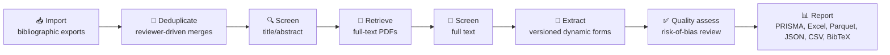

# 📑 Papertrail

**Self-hosted, multi-user structured literature reviews — with a human always in the loop.**

Papertrail imports bibliographic exports and optional full-text PDFs, preserves source provenance and PDF version history, supports duplicate review and configurable multi-reviewer screening, tracks full-text retrieval (manual, or browser-assisted through an optional paired Chrome extension), and provides optional evidence-backed extraction suggestions through an external Ollama service. Reviewer-controlled extraction and quality-assessment data remain authoritative.

<p>
  
  
  
  
  
</p>

## 🔄 The review pipeline



Significant workflow, administrative, and reviewer actions are recorded in an immutable audit trail, and an optional local LLM can suggest (but never decide) screening and extraction answers.

## ✨ Features

- **Import and provenance:** import bibliographic exports from multiple databases
- **PDF management:** attach full-text PDFs with version history, stored locally; an optional paired Chrome extension can retrieve them through the reviewer's own browser network access and sign-in state
- **Duplicate review:** configurable duplicate scoring with reviewer-driven merge decisions
- **Multi-reviewer screening:** title/abstract and full-text screening stages with configurable reviewer counts and conflict resolution
- **Dynamic extraction forms:** versioned, project-defined forms with stable field identifiers for structured data extraction, optionally with two independent extractors per publication and adjudicator-led reconciliation of disagreements
- **Quality assessment:** reviewer-recorded quality/risk-of-bias evaluation, kept separate from extraction data
- **Optional LLM assistance:** evidence-backed suggestions for screening, extraction, and validation, plus source-cited research-question synthesis, via an external Ollama service; suggestions are advisory only and reviewer decisions remain authoritative
- **Charts & Analysis:** anonymized inter-reviewer agreement, a searchable/filterable evidence matrix of every result with its source traceable, and optional LLM-generated per-research-question synthesis
- **Reporting and export:** PRISMA flow outputs, Excel workbooks, Parquet datasets, JSON and CSV exports, and BibTeX export
- **Audit trail:** durable audit logging of workflow and reviewer actions
- **Role-based access:** project-scoped membership so reviewers only see projects and actions they're eligible for

## 🏗️ Architecture

- FastAPI, Pydantic, SQLAlchemy 2, and Alembic
- PostgreSQL
- React and TypeScript with Vite
- TanStack Query and React Hook Form
- PostgreSQL-backed multithreaded worker
- Docker Compose production deployment

Papertrail is a modular monolith. The API and worker share domain services and one authoritative database.

PDF binaries are stored in a dedicated persistent filesystem volume, while their metadata and stable document IDs are stored in PostgreSQL. The Papertrail server never scrapes publisher full text using server-side institutional credentials. Reviewers upload PDFs directly, or pair the optional `browser-extension/` Chrome Manifest V3 extension (see [Reviewer guide](docs/user-guide.md#browser-assisted-pdf-retrieval)) so PDFs are retrieved through their own browser's network access and sign-in state and then uploaded through the same authoritative PDF pipeline.

A high-level overview of the Papertrail architecture:

[](docs/architecture.md)

For a detailed description of the components and data flows, see the
[architecture documentation](docs/architecture.md).

## 🚀 Local development

Local development uses Docker only for PostgreSQL. FastAPI, the worker, and Vite run directly on the host.

### Windows PowerShell

```powershell
Copy-Item .env.development.example .env.development
Set-ExecutionPolicy -Scope Process Bypass
.\scripts\dev.ps1 setup
.\scripts\dev.ps1 create-admin
.\scripts\dev.ps1 start
```

Open http://localhost:5173.

### macOS or Linux

```bash
cp .env.development.example .env.development
./scripts/dev.sh setup
./scripts/dev.sh create-admin
```

Then run `api`, `worker`, `llm-worker`, and `frontend` in separate terminals. `llm-worker` runs the resource-limited Ollama worker and stays idle when LLM assistance is disabled (the default).

See the [local-development guide](docs/local-development.md) for manual setup, testing, database management, IDE configuration, and troubleshooting.

## 📦 Production deployment

```bash
cp .env.example .env
# Replace all example passwords, set PAPERTRAIL_IMAGE_TAG, and configure the public hostname.
docker compose up -d
```

The one-shot migration container applies the database migrations and creates the
administrator from `PAPERTRAIL_ADMIN_USERNAME`, `PAPERTRAIL_ADMIN_DISPLAY_NAME`,
and `PAPERTRAIL_ADMIN_PASSWORD` before the API starts.

See [Installation](docs/installation.md) for production configuration.

## 📚 Documentation

| Guide | Description |
| --- | --- |
| [Local development](docs/local-development.md) | Manual setup, testing, database management, troubleshooting |
| [Architecture](docs/architecture.md) | System design and component overview |
| [Administrator guide](docs/administrator-guide.md) | Managing users, projects, jobs, integrity, and global settings |
| [Reviewer guide](docs/user-guide.md) | Screening, PDFs, account settings, extraction, quality assessment, and analysis |
| [Developer guide](docs/developer-guide.md) | Contributing and codebase conventions |
| [Frontend testing](docs/frontend-testing.md) | Running and writing frontend tests |
| [Configuration](docs/configuration.md) | Environment variables, Global Settings, precedence, and runtime behavior |
| [Browser Helper](docs/browser-helper.md) | Installing, pairing, and operating browser-assisted PDF retrieval |
| [Backup and restore](docs/backup-and-restore.md) | Data durability and disaster recovery |
| [Import formats](docs/import-formats.md) | Supported bibliographic export formats |
| [LLM-assisted extraction](docs/llm-assisted-extraction.md) | How the optional Ollama integration works |
| [API overview](docs/api.md) | API conventions and integration overview; `/docs` and `/openapi.json` are authoritative |

## License

Papertrail is licensed under the GNU Affero General Public License
v3.0 only (AGPL-3.0-only). See [LICENSE](LICENSE) for details.